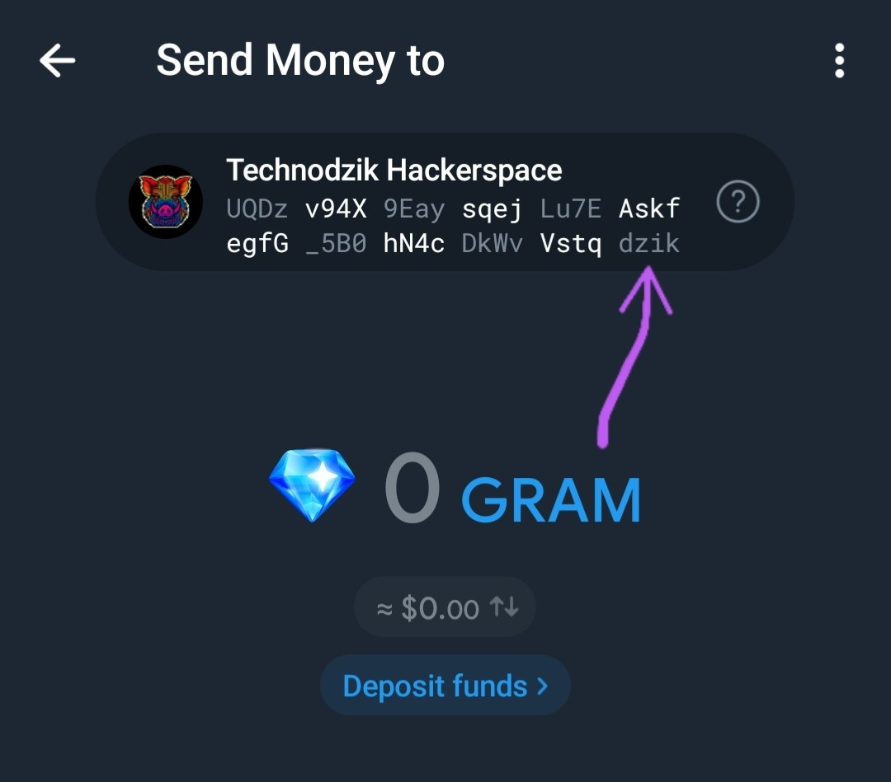

# vanity-ton-wallet-crafter

Offline vanity-address generator for TON wallets.
It finds a recovery phrase whose wallet address ends with a suffix you choose, e.g. `UQ…YEAH`.

<p align="center"></p>

| `wallet`   | for                                         | phrase                 |
|------------|---------------------------------------------|------------------------|
| `telegram` | Telegram's built-in wallet                  | 12 words, BIP-39       |
| `v4r2`     | Tonkeeper / MyTonWallet / Tonhub, v4R2      | 24 words, TON mnemonic |
| `v5r1`     | Tonkeeper / MyTonWallet, W5 (v5R1)          | 24 words, TON mnemonic |
| `ledger`   | Ledger TON app, account #1 (V4R2 contract)  | 24 words, BIP-39       |

## Install

Prebuilt binaries for macOS (Apple Silicon and Intel) and Linux x86_64 are attached to each
[release](https://github.com/technodzik-hackerspace/vanity-ton-wallet-crafter/releases).
Every CI run also keeps them as workflow artifacts.

On a Mac with Apple Silicon (M1–M5):

```bash
shasum -a 256 -c vanity-ton-wallet-crafter-*-aarch64-apple-darwin.tar.gz.sha256
tar -xzf vanity-ton-wallet-crafter-*-aarch64-apple-darwin.tar.gz
cd vanity-ton-wallet-crafter-*-aarch64-apple-darwin
xattr -d com.apple.quarantine vanity-ton-wallet-crafter  # not Apple-notarized, so Gatekeeper blocks it
./vanity-ton-wallet-crafter
```

### Nix

The flake builds for `aarch64-darwin`, `x86_64-linux` and `aarch64-linux`:

```bash
nix run github:technodzik-hackerspace/vanity-ton-wallet-crafter -- --wallet v5r1 _TON
```

With nix-darwin (or NixOS), add the flake as an input and install its package:

```nix
# flake.nix
inputs.vanity-ton-wallet-crafter = {
  url = "github:technodzik-hackerspace/vanity-ton-wallet-crafter";
  inputs.nixpkgs.follows = "nixpkgs";
};

# darwin configuration module (gets `inputs` via specialArgs)
{ inputs, pkgs, ... }: {
  environment.systemPackages = [
    inputs.vanity-ton-wallet-crafter.packages.${pkgs.stdenv.hostPlatform.system}.default
  ];
}
```

Or apply `inputs.vanity-ton-wallet-crafter.overlays.default` and use `pkgs.vanity-ton-wallet-crafter`.
Nix-built binaries need no quarantine step. With `nixpkgs.follows`, your nixpkgs must ship Rust 1.96.1 or newer.

### From source

Rust 1.96.1 or newer:

```bash
cargo build --release
./target/release/vanity-ton-wallet-crafter
```

## Usage

Edit `targets.toml`, then run the binary.

Options:

```
--config FILE   read targets from FILE instead of ./targets.toml
--wallet KIND   telegram, v4r2, v5r1 or ledger (overrides the config; default telegram)
--threads N     worker threads (default: all cores)
SUFFIX...       suffixes on the command line override the list in the config
```

It prints progress every 10 s and stops at the first match.
Before searching, it checks the derivation for the chosen wallet against known test vectors.

## How the address is derived

**telegram**: what Telegram's own [wallet engine](https://github.com/dkaraush/wallet-engine) derives on import,
pinned to the revision Telegram Android 13.0.2 ships. A hit is re-checked through the engine's
`WalletLifecycle::import_wallet`, exactly what the app runs when you import a phrase:

```
12 words (BIP-39, 128-bit entropy)
  → PBKDF2-HMAC-SHA512(words, "mnemonic", 2048)  → SLIP-10 ed25519 m/44'/607'/0'  → anchor key
data    = uint8 0 | uint32 seqno 0 | uint32 0x7FFF7F11 (mainnet) | anchor key
address = 0 : hash(StateInit{ wallet trampoline, data })
```

The address depends only on the anchor key, so it survives later key rotations.

**v4r2 / v5r1**: the TON mnemonic scheme, through the `ton` SDK that the same wallet-engine revision vendors:

```
24 random words, redrawn until PBKDF2(HMAC-SHA512(words), "TON seed version", 390)[0] == 0
  → PBKDF2-HMAC-SHA512(HMAC-SHA512(words), "TON default seed", 100000) → ed25519 key
v4r2: data = seqno 0 | subwallet 698983191 | key | no plugins
v5r1: data = signatures on | seqno 0 | wallet id 0x7FFFFF11 (testnet 0x7FFFFFFD) | key | no extensions
```

**ledger**: what the Ledger TON app derives for account #1 (`HDW_ED25519_SLIP10`, `DEFAULT_SUBWALLET_ID`):

```
24 words (BIP-39, 256-bit entropy)
  → PBKDF2-HMAC-SHA512(words, "mnemonic", 2048) → SLIP-10 ed25519 m/44'/607'/0'/0'/0'/0' (testnet: 607'/1')
  → V4R2, subwallet 698983191
```

The search derives eight phrases at once with AVX-512 when the CPU has it (AMD Zen 4 and later,
Intel Xeon; not most Intel desktop chips or Apple Silicon). Every hit is then derived again, one
phrase at a time, through the engine, the `ton` SDK or the `pbkdf2` crate, and must give the same address.

Wallets show the non-bounceable form (`UQ…`); the bounceable form (`EQ…`) ends differently.
A hit whose phrase also validates under another scheme (for example, a TON phrase that is also
valid BIP-39) is skipped, so wallet apps cannot import it as a different wallet.

## Cost

Every suffix character multiplies the search by 64. Measured on a Ryzen AI Max+ 395
(16 cores, 32 threads, AVX-512); without AVX-512 the same CPU is about 5.5 times slower:

| wallet | attempts/s | 3 chars | 4 chars | 5 chars |
|---|---|---|---|---|
| `telegram` | ~147,000 | ~2 s | ~2 min | ~2 hours |
| `ledger` | ~142,000 | ~2 s | ~2 min | ~2 hours |
| `v4r2`, `v5r1` | ~1,600 | ~3 min | ~3 hours | ~8 days |

The TON mnemonic is slow by design (about 200,000 PBKDF2 rounds per usable phrase).
Several acceptable suffixes, or `case_insensitive = true`, shorten it proportionally.

## Safety

- Nothing touches the network; the phrase is only printed to the terminal. Clear it afterwards.
- Entropy comes from the OS CSPRNG. Choosing among candidates does not weaken the phrase.
- Import the phrase into the target wallet and confirm it shows the same `UQ…` address before funding it.
- Telegram: keep the "encrypted backup" off if Telegram must not be able to reconstruct the phrase.
- Ledger: a phrase generated on a computer was never only inside the device. That gives up the
  main guarantee of a hardware wallet. Use an offline machine and accept that trade-off knowingly.

## License

Licensed under [MIT license](LICENSE-MIT).
